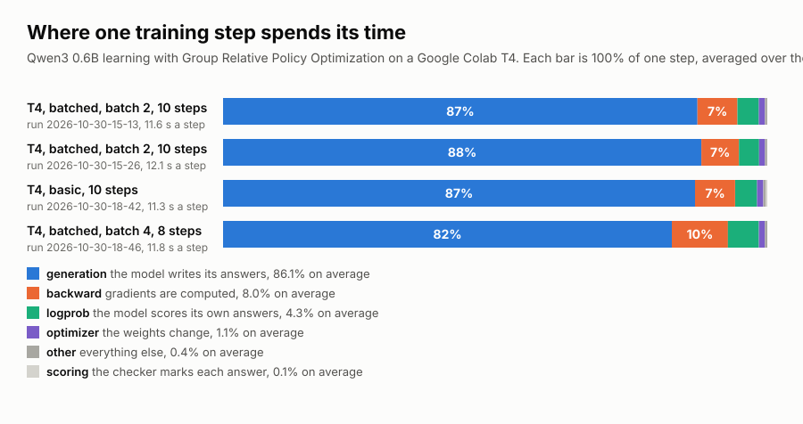

# Group Relative Policy Optimization (GRPO) stopwatch

**Where does the time go when a small model learns by trial and error?** The model is an artificial intelligence (AI) program.

[](https://colab.research.google.com/github/crdtk/timing-group-relative-policy-optimization-grpo/blob/main/rl_velocity.ipynb)
[](LICENSE)



## The answer in one minute

- The model spends 88% of every training step writing its answers.
- Marking, scoring and updating take the other 12%.
- Two runs on a free Google Colab graphics processing unit (GPU) agree within one point.

To speed up this kind of training, speed up the answer writing first.

## Who this is for

Anyone curious about how AI models learn from trial and error. You need no background. The next section explains the idea with one small example.

## What GRPO is

GRPO trains a language model. The model answers one question several times. The training rewards answers above the group's average.

### A worked example

Question: What is 47 + 36?

The model writes four attempts. Each attempt is a rollout.

| Attempt | What the model wrote | Checker marks |
|---|---|---|
| A | 40 + 30 = 70. 7 + 6 = 13. 70 + 13 = 83. Answer: 83 | right, 1 point |
| B | About 80. Answer: 80 | wrong, 0 points |
| C | 7 + 6 = 13, write 3, carry 1. 4 + 3 + 1 = 8. Answer: 83 | right, 1 point |
| D | Answer: 73 | wrong, 0 points |

A small program, the verifier, checks each final number against 83.

The class scored 1, 1, 0, 0. The class average is 0.5. Attempts A and C score above it. Attempts B and D score below it. Each attempt gets a plus mark or a minus mark from the comparison. The marks are about plus 0.87 and minus 0.87. Researchers call each mark the advantage.

Training then adjusts the model. It becomes slightly more likely to write the words of A and C. It becomes slightly less likely to write the words of B and D. The checker only marks the final number. The model chose small steps itself. Attempts with small steps scored above the average.

One adjustment is tiny. The loop repeats on thousands of questions. The "policy" is just the model.

Writing the four attempts is the generation stage. In the lab it takes 87% of each step.

A program grades the math answers. Researchers call the method reinforcement learning with verifiable rewards (RLVR).

### The second judge model

Older methods, such as Proximal Policy Optimization (PPO), train a second network, the critic. The critic guesses the score each answer should get. It matches the model in size. The memory use doubles. GRPO removes the critic. The four scores of one question give the comparison instead. The price is more generation, because every question needs several answers.

**An example with two teachers**

Same question: What is 47 + 36? A mark means a score minus an expectation. The two methods set the expectation in different ways.

| | Method A: a critic | Method B: GRPO |
|---|---|---|
| Who sets the expectation | a second model, before any attempt | the four attempts, after they are scored |
| Expectation | 0.6, a guess from past questions | 0.5, the average of 1, 1, 0, 0 |
| Mark for attempt A (score 1) | plus 0.4 | plus 0.5 |
| Mark for attempt B (score 0) | minus 0.6 | minus 0.5 |
| Extra cost | a full second model, trained and stored | three more attempts per question |

Picture a teacher marking a test. Method A hires an assistant to guess the class result before the test. Method B waits and averages the real papers.

GRPO uses one model. Its expectation comes from the room, not from a guess. The worked example shows the same marks as plus and minus 0.87. The spread scales them.

### Why the model writes steps

The reward counts the final answer alone. Answers built from small pieces reach the right number more often. Those answers score 1 and become more likely. Guessed answers score 0 more often and become less likely. Over thousands of questions, writing steps becomes the model's usual way. Longer answers correlate with correct ones. The link covers whole answers, not single steps.

### When every attempt scores the same

Question: What is 1 + 1? All four attempts write 2. The scores are 1, 1, 1, 1 and the average is 1. Every attempt sits at the average. All four wrong gives the same result. Both cases mean zero spread. Every advantage is zero. The update leaves the model as it is. The code may skip it. The setting `SKIP_ZERO_ADVANTAGE` turns the skip on.

## What the notebook measures

`rl_velocity.ipynb` runs Sebastian Raschka's GRPO script with a stopwatch on five stages:

| Stage | What happens |
|---|---|
| generation | the model writes its rollouts |
| scoring | the verifier checks each answer |
| logprob | the model scores its own answers, a forward pass |
| backward | the gradients are computed |
| optimizer | the weights change |

Each timer waits for the GPU to finish first. GPU work runs in the background and would count toward the wrong stage otherwise.

The script is Raschka's, from [rasbt/reasoning-from-scratch](https://github.com/rasbt/reasoning-from-scratch), Apache 2.0, pinned to commit `2e5e94d47af421d02236f0c28c3525592ceff6c8`. Model: Qwen3 0.6B base.

## Results

Both runs use the batched script, batch 2, 4 rollouts, 256 tokens, seed 42 and a Tesla T4. Each run took ten steps. Step 1 is left out of the means, because it includes warm-up work.

| Stage | Run 1, seconds | Run 1, share | Run 2, seconds | Run 2, share |
|---|---|---|---|---|
| generation | 10.11 | 87.2% | 10.59 | 87.9% |
| backward | 0.85 | 7.3% | 0.83 | 6.9% |
| logprob | 0.46 | 3.9% | 0.45 | 3.7% |
| optimizer | 0.13 | 1.1% | 0.13 | 1.1% |
| other | 0.05 | 0.4% | 0.05 | 0.4% |
| scoring | 0.00 | 0.0% | 0.00 | 0.0% |
| one step | 11.6 | | 12.1 | |
| speed, tokens per second | 18.1 | | 17.5 | |

The files are `results/2026-10-30-15-13-T4.csv` and `results/2026-10-30-15-26-T4.csv`. Both runs share one seed. Their rewards match step by step.

## Run it yourself

### Option A: in your browser, no install

Click the Open in Colab badge at the top. Then skip to the Runtime steps below. To start from the file instead, follow the whole list.

- Open [Google Colab](https://colab.research.google.com) and sign in.
- Choose File, then Upload notebook. Pick `rl_velocity.ipynb`.
- Choose Runtime, then Change runtime type. Pick the T4 GPU.
- Choose Runtime, then Run all.

The first run downloads a 1.4 gigabyte model. The last cell prints the stage table and a chart. The notebook saves a comma-separated values (CSV) file in the Files panel on the left.

### Option B: one command

```
make                                 the notebook's defaults on a T4
make SCRIPT=basic                    rollouts one after another
make SCRIPT=batched BATCH=4          rollouts in batches of four
make SKIP_ZERO_ADVANTAGE=1           skip updates that carry no signal
make CSV=my-run.csv                  name the file yourself
make chart                           redraw docs/stage-breakdown.svg from results/
```

Settings you can name: `SCRIPT`, `STEPS`, `ROLLOUTS`, `TOKENS`, `BATCH`, `SEED`, `SKIP_ZERO_ADVANTAGE`, `REPO_URL`, `REPO_REF`. Also `GPU` (default T4) and `TIMEOUT` (default 3600 seconds).

The run uses the official Colab command line tool. Without `colab` installed, it runs through `uvx`. The first run asks for a Google sign-in. Tick every permission box on the consent screen. A smaller grant makes the sign-in fail.

The run executes a temporary copy. The output notebook stays in the temporary folder.

## The result file

One CSV per run in `results/`, named `YYYY-MM-DD-HH-MM-<GPU><settings>.csv`. Every row holds one step.

| Group | Columns |
|---|---|
| Settings and versions, repeated in every row | `script`, `batch`, `rollouts`, `tokens`, `seed`, `skip_zero`, `gpu`, `torch`, `cuda`, `repo_commit`, `notebook`, `run` |
| Timing | `generation_s`, `scoring_s`, `logprob_s`, `backward_s`, `optimizer_s`, `timed_s`, `wall_s`, `other_s`, `tokens_per_sec` |
| Training | `avg_response_len`, `reward_avg`, `loss` |

A failed run, for example out of memory, keeps its partial rows as `<name>.csv.failed`.

## Limits

- Ten steps and one seed.
- The base model writes short answers.
- Most steps scored zero reward. Backward ran on a zero loss. The skip setting awaits a measurement.
- One GPU type. Other cards may split the time differently.

## Next

- Rollouts through vLLM instead of the plain loop. vLLM is an open source engine for serving language models fast. Generation is the stage to shrink.
- A run with `SKIP_ZERO_ADVANTAGE=1`.
- Fixed output lengths give clean comparisons.
- Raschka's script for two GPUs.

## What is in this repo

| Path | What it holds |
|---|---|
| `rl_velocity.ipynb` | the notebook with the stopwatch |
| `Makefile` | one command that runs the notebook on Colab and downloads the CSV |
| `make_chart.py` | draws the chart from the CSV files |
| `docs/stage-breakdown.svg` | the chart at the top of this page |
| `results/` | one CSV per run |
| `LICENSE` | the MIT license |

## License

This repo uses the MIT license. The notebook downloads Sebastian Raschka's training script. That script keeps its own Apache 2.0 license.

## References

- Video: [RLHF Explained, PPO, DPO, GRPO and How LLMs Learn Human Preferences](https://www.youtube.com/watch?v=-RfQiTwCF2Y). Background on how large language models (LLMs) learn from human feedback. It covers Proximal Policy Optimization (PPO), direct preference optimization (DPO) and GRPO. RLHF means reinforcement learning from human feedback.
- Code: [rasbt/reasoning-from-scratch](https://github.com/rasbt/reasoning-from-scratch), Apache 2.0.
